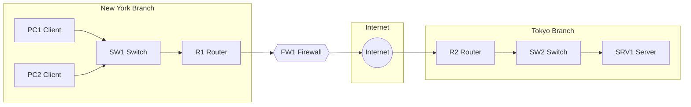

---
tags:
  - ccna
  - networking
  - moc
aliases:
  - Network Devices
  - 01 Network Devices
---

# 🧭 Network Devices

> [!abstract] Folder Overview
> This folder covers the **building blocks of a network** — the devices that move, serve, and secure traffic — plus the client/server relationship that defines how services are requested and provided.

## 📚 Notes in This Folder

| Note | What It Covers | Exam Focus |
| --- | --- | --- |
| [[Network]] | Nodes and client/server roles | A client **requests**; a server **provides** |
| [[Router]] | Connects separate LANs | Forwards traffic **between** networks |
| [[Switches]] | Connects hosts inside a LAN | Forwards traffic **within** a LAN |
| [[Firewall]] | Filters traffic using rules | Placed **inside** or **outside** the network |
| [[Server]] | Provides services to clients | Responds to requests |
| [[Clients]] | Requests services from servers | Initiates the request |

## 🗺️ How the Pieces Fit Together

> [!example] Following the path
> 1. PC1 in New York requests a file from SRV1 in Tokyo.
> 2. The request goes to **R1** via **SW1**.
> 3. R1 forwards it through the firewall and over the Internet to **R2**.
> 4. R2 sends it to **SRV1** via **SW2**.
> 5. The reply follows the reverse path back to PC1.

## 🔑 Key Exam Points

> [!important] Must-know facts
> - A **client** requests a service; a **server** provides it. These are **roles**, not fixed device types.
> - A **switch** connects end hosts **within the same LAN** and usually has **24+ ports**.
> - A **router** connects **different LANs** and forwards data over the Internet. It has **fewer interfaces** than a switch.
> - Switches **cannot** connect LANs or reach the Internet on their own — they need a router.
> - A **firewall** allows or denies traffic based on **configured rules**.
> - Firewalls can sit **outside** the router or **inside** the network.
> - **Next-generation firewalls** include more advanced filtering capabilities.

## ⚖️ Router vs Switch vs Firewall

| Device | Connects | Interfaces | Key Job |
| --- | --- | --- | --- |
| **Switch** | Hosts within a LAN | Many (24+) | Forward traffic inside the LAN |
| **Router** | Separate LANs | Fewer | Forward traffic between networks / Internet |
| **Firewall** | Inside ↔ outside | Varies | Allow or deny traffic using rules |

## 👥 Client vs Server

| Role | Responsibility | Example |
| --- | --- | --- |
| **Client** | Accesses a service made available by a server | PC1 requesting `image.jpg` |
| **Server** | Provides functions or services for clients | PC2 sending `image.jpg` |

> [!tip] Remember
> The same device can act as a **client** in one exchange and a **server** in another — it depends on who is requesting and who is providing.

## 🧱 Types of Firewalls

| Type | Description |
| --- | --- |
| **Network Firewall** | Hardware that filters traffic between networks |
| **Host-based Firewall** | Software that filters traffic entering and exiting a host |

## ✅ Exam Checklist

- [ ] I can explain the difference between a client and a server.
- [ ] I can state the difference between a switch and a router.
- [ ] I know where a firewall can be placed in a network.
- [ ] I can name the two types of firewalls.
- [ ] I can trace traffic from one LAN to another through routers and switches.

## 📝 Practice Exam

- [[Network Devices Exam]] — 30-mark self-test with answers

## 🧪 Lab

- [[Day 01 Lab - Packet Tracer Introduction.pkt]]

---

### 🔗 Related Notes
[[Network]] · [[Router]] · [[Switches]] · [[Firewall]] · [[Server]] · [[Clients]] · [[Interfaces And Cables]]
