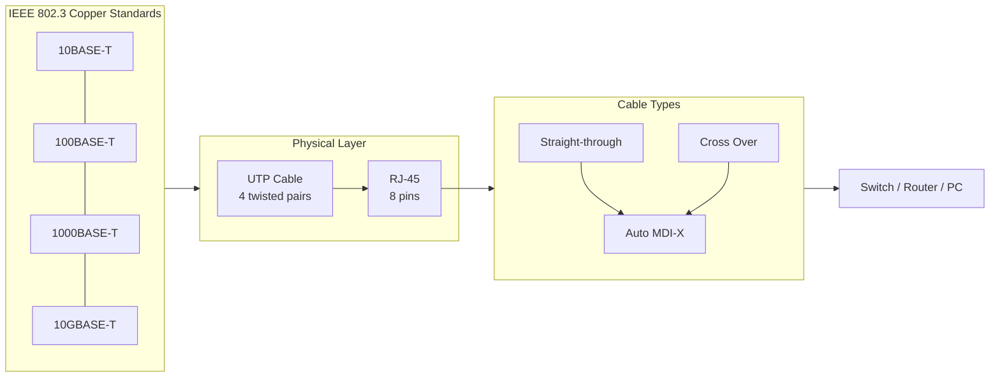

---
tags:
  - ccna
  - networking
  - cabling
  - moc
aliases:
  - Interfaces
  - Interfaces and Cables
  - 02 Interfaces And Cables
---

# 🔌 Interfaces & Cables

> [!abstract] Folder Overview
> This folder covers how devices physically connect — the **interfaces (ports)**, **copper cabling standards**, and **pin wiring** that let Ethernet equipment from different vendors interoperate.

## 📚 Notes in This Folder

| Note | What It Covers | Exam Focus |
| --- | --- | --- |
| [[Bits and Bytes]] | Bits vs bytes and serial transmission | **1 byte = 8 bits**; speed is in **bits/s** |
| [[Network Protocols]] | Why agreed-upon standards matter | **Physical** vs **logical** standards |
| [[Ethernet]] | Collection of protocols and standards | Ethernet is a **family**, not one protocol |
| [[Ethernet Standards (copper)]] | IEEE 802.3 copper standards | **10/100/1000/10G**; **BASE-T** |
| [[UTP Cable]] | Unshielded twisted pair and RJ-45 | **4 pairs = 8 wires**; twist fights **EMI** |
| [[10BASE-T, 100BASE-T]] | 10/100 Mbps pin usage | **2 pairs** — pins **1&2**, **3&6** |
| [[1000BASE -T, 10GBASE-T]] | 1/10 Gbps pin usage | **All 4 pairs**, each **bidirectional** |
| [[Straight-through cable]] | Pin 1 to pin 1 wiring | Connects **unlike** devices |
| [[Cross Over Cable]] | Reversed pin pairs | Connects **like** devices |
| [[Auto MDIX]] | Automatic pin detection | Modern gear needs **no crossover** |

## 🗺️ How the Pieces Fit Together

> [!example] Following the signal
> 1. A [[Bits and Bytes|bit]] is sent as a variation in the electrical signal on a **UTP** wire.
> 2. The wire terminates in an **RJ-45** connector with **8 pins**.
> 3. The **Ethernet standard** (10/100/1000/10G) decides how many pairs are used.
> 4. The **cable type** (straight-through or crossover) decides which pin reaches which pin.
> 5. **Auto MDI-X** can correct a "wrong" cable automatically on modern devices.

## 🔑 Key Exam Points

> [!important] Must-know facts
> - **UTP** = **Unshielded Twisted Pair** — 4 pairs, **8 wires**, no metallic shield.
> - The **twist** reduces **electromagnetic interference (EMI)**.
> - Copper Ethernet standards are defined by **IEEE 802.3**.
> - In a standard name, the number is the **speed**, **BASE** means **baseband**, and **T** means **twisted pair**.
> - **10BASE-T** and **100BASE-T** use **2 pairs (4 wires)**: pins **1&2** and **3&6**.
> - **1000BASE-T** and **10GBASE-T** use **all 4 pairs (8 wires)**, each **bidirectional**.
> - PCs, routers, and firewalls **transmit on 1&2** and **receive on 3&6**.
> - Switches are the opposite: **transmit on 3&6** and **receive on 1&2**.
> - Ethernet is **full-duplex** — devices send and receive at the same time.
> - A **straight-through** cable connects **unlike** devices; a **crossover** connects **like** devices.
> - **Auto MDI-X** detects the neighbor's pins and adjusts automatically.

## ⚖️ Copper Ethernet Standards

| Standard | Speed | Also Known As | Pairs Used | Wires |
| --- | --- | --- | --- | --- |
| **10BASE-T** | 10 Mbps | Ethernet | 2 (1&2, 3&6) | 4 |
| **100BASE-T** | 100 Mbps | Fast Ethernet | 2 (1&2, 3&6) | 4 |
| **1000BASE-T** | 1 Gbps | Gigabit Ethernet | 4 | 8 |
| **10GBASE-T** | 10 Gbps | 10-Gigabit Ethernet | 4 | 8 |

## 🔀 Straight-Through vs Crossover

| Cable | Wiring | Connects | Example |
| --- | --- | --- | --- |
| **Straight-through** | Pin 1 → 1, 2 → 2, 3 → 3, 6 → 6 | **Unlike** devices | PC ↔ switch, router ↔ switch |
| **Crossover** | Pin 1 → 3, 2 → 6, 3 → 1, 6 → 2 | **Like** devices | PC ↔ PC, switch ↔ switch, router ↔ router |

> [!tip] Remember
> Unlike devices **already** use opposite pin pairs, so a **straight-through** cable works. Like devices use the **same** pairs, so the cable must **cross** them.

## 📌 Pin Roles by Device

| Device | Transmits On | Receives On |
| --- | --- | --- |
| **PC** | 1 & 2 | 3 & 6 |
| **Router** | 1 & 2 | 3 & 6 |
| **Firewall** | 1 & 2 | 3 & 6 |
| **Switch** | 3 & 6 | 1 & 2 |

## ✅ Exam Checklist

- [ ] I can expand **UTP** and explain why the pairs are twisted.
- [ ] I know how many pairs each copper standard uses.
- [ ] I can state which pins PCs, routers, firewalls, and switches transmit and receive on.
- [ ] I can explain why a straight-through cable works for PC-to-switch.
- [ ] I can explain why two switches need a crossover cable (or Auto MDI-X).
- [ ] I can describe what Auto MDI-X does.

## 📝 Practice Exam

- [[Interfaces And Cables Exam]] — 30-mark self-test with answers

---

### 🔗 Related Notes
[[Network Devices]] · [[Network]] · [[Ethernet]] · [[Ethernet Standards (copper)]] · [[UTP Cable]] · [[10BASE-T, 100BASE-T]] · [[1000BASE -T, 10GBASE-T]] · [[Straight-through cable]] · [[Cross Over Cable]] · [[Auto MDIX]]
