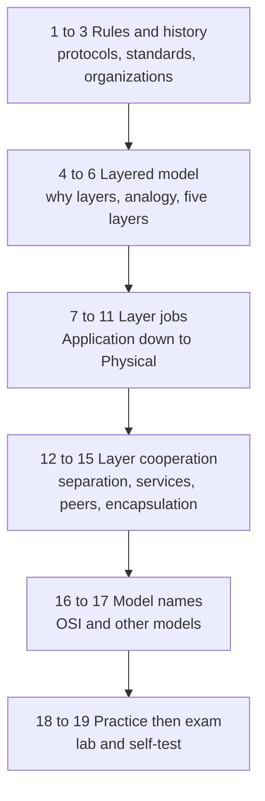

---
tags:
  - ccna
  - networking
  - tcpip
  - moc
aliases:
  - TCP/IP
  - TCP IP
  - 03 TCP IP
---

# 🌐 TCP/IP

> [!abstract] Folder Overview
> This folder covers the **rules, history, organizations, and layered model** behind internetworking — why protocols and standards are needed, how TCP/IP grew, and how a message moves from an application to another host.

> [!tip] Start here — read top to bottom
> Finish [[Interfaces And Cables]] first. Work through the stages below in order — every note ends with a **🧭 Learning Path** link to the next one.

## 🧭 Learning Path

| # | Stage | Note | What you'll learn |
| --- | --- | --- | --- |
| 1 | 🌱 Basics | [[Standards And Protocols]] | Protocols, standards, and vendor neutrality |
| 2 | 📜 History | [[History]] | ARPANET → NCP → TCP/IP (1983) |
| 3 | 🏛️ Governance | [[Who Defines The Standards]] | IEEE, IETF, and RFCs |
| 4 | 🧱 Models | [[Layered models]] | Why networking is split into layers |
| 5 | ✉️ Analogy | [[Analogy building a Model]] | The mail system model |
| 6 | 🧭 Model | [[The TCP IP Model]] | The five-layer course model |
| 7 | 📱 Layer 5 | [[Layer 5 Application Layer]] | Application data and protocols |
| 8 | 🚚 Layer 4 | [[Layer 4 Transport Layer]] | Ports, TCP, and UDP |
| 9 | 🌍 Layer 3 | [[Local 3 Internet Layer]] | IP addresses and routers |
| 10 | 🏠 Layer 2 | [[Local 2 Network Layer]] | MAC addresses and next hops |
| 11 | ⚡ Layer 1 | [[Layer 1 Physical Layer]] | Bits and signals |
| 12 | 🧩 Concepts | [[Separation of Layers]] | Why layers are modular |
| 13 | 🤝 Concepts | [[Adjacent-layer interaction]] | Services between neighboring layers |
| 14 | 🔁 Concepts | [[Same Layer Interaction]] | Logical peer-layer communication |
| 15 | 📦 Concepts | [[Encapsulation & decapsulation]] | Headers, trailers, and message flow |
| 16 | 🏛️ Models | [[OSI Model]] | The 7-layer reference model |
| 17 | 🧭 Models | [[Other Model]] | Different model names |
| 18 | 🧪 Practice | [[Day 03 Lab - OSI Model.pkt]] | Apply the model in a lab |
| 19 | 📝 Check | [[TCP IP Exam]] | Test what you learned |

## 🏗️ Knowledge Hierarchy

## 🗺️ How the Pieces Fit Together

```mermaid
flowchart LR
    subgraph PROBLEM["The Problem"]
        P1[Vendor A<br/>proprietary protocol] -. cannot interoperate .-> P2[Vendor B<br/>proprietary protocol]
    end

    subgraph SOLUTION["The Solution"]
        S1[Open standards] --> S2[IEEE 802.3 / 802.11]
        S1 --> S3[IETF RFCs<br/>TCP, IP, UDP, HTTP, DNS]
    end

    P1 --> S1
    P2 --> S1
    S2 --> V[Vendors implement standards]
    S3 --> V
    V --> M[Devices interoperate]
    M --> L[Layered model<br/>split the job]

    subgraph STACK["Five-Layer Stack"]
        APP[Application<br/>data] --> TR[Transport<br/>ports]
        TR --> IN[Internet<br/>IP]
        IN --> LN[Local Network<br/>MAC]
        LN --> PH[Physical<br/>bits]
    end

    L --> STACK
    PH --> SIG[Signals over the medium]
    SIG --> ENC[Encapsulation / decapsulation]
    ENC --> OSI[OSI names<br/>Layer 7 / Layer 3 / Layer 2]
    OSI --> LAB[Lab]
    LAB --> EXAM[Exam]
```

> [!example] Following a web request
> 1. The **Application** layer creates an HTTP request.
> 2. The **Transport** layer adds source and destination **port numbers** to identify the process.
> 3. The **Internet** layer adds **IP addresses** to identify the source and final destination hosts.
> 4. The **Local Network** layer adds **MAC addresses** to deliver the frame to the next hop.
> 5. The **Physical** layer sends the bits as electrical, optical, or radio signals.
> 6. The receiver reverses the process with **decapsulation**, then the application processes the request.

## 🔑 Key Exam Points

> [!important] Must-know facts
> - A **protocol** is a set of rules defining how devices communicate.
> - A **standard** is an agreed-upon specification describing how a protocol or technology works.
> - **Proprietary** vendor-specific protocols prevent interoperability; **vendor-neutral standards** allow devices from different vendors to work together.
> - **IEEE** develops LAN standards: **802.3 = Ethernet**, **802.11 = Wi-Fi**. Its standards cover physical specs and message formatting.
> - **IETF** defines Internet protocols — **TCP, IP, UDP, HTTP, DNS** — and publishes them as **RFCs**.
> - **ARPANET** came online in **1969**, originally used **NCP**, and fully switched to TCP/IP on **1 January 1983**.
> - **Vint Cerf and Bob Kahn** began developing **TCP in 1974**; it was later split into **TCP** and **IP**.
> - A **layered model** splits networking jobs into smaller parts; each layer uses the layer below and serves the layer above.
> - **Layer 5 — Application:** creates, formats, and interprets application data.
> - **Layer 4 — Transport:** process-to-process communication using **port numbers**; main protocols are **TCP** and **UDP**.
> - **Layer 3 — Internet:** host-to-host delivery using **IP addresses**; routers operate mainly here.
> - **Layer 2 — Local Network:** hop-to-hop delivery using **MAC addresses**; switches operate here.
> - **Layer 1 — Physical:** sends bits as electrical, optical, or radio signals over the medium.
> - **Encapsulation** adds headers/trailers going down the stack; **decapsulation** removes them going up.
> - **Adjacent-layer interaction** happens inside one device; **same-layer interaction** happens logically between matching layers on different devices.
> - **Separation of layers** means one layer can change without redesigning every other layer.
> - **OSI** is a 7-layer reference model; TCP/IP won in real deployment, but OSI names are still widely used.
> - Common names: Application = **Layer 7**, Internet = **Layer 3 / Network**, Local Network = **Layer 2 / Data Link**.

## ⚖️ IEEE vs IETF

| Org | Full name | Focus | Examples | Publishes as |
| --- | --- | --- | --- | --- |
| **IEEE** | Institute of Electrical and Electronics Engineers | LAN physical & framing standards | 802.3 Ethernet, 802.11 Wi-Fi | 802.x standards |
| **IETF** | Internet Engineering Task Force | Internet protocols | TCP, IP, UDP, HTTP, DNS | RFCs (Requests for Comments) |

## 🧱 5-Layer Model at a Glance

| Layer | Name | Main job | Addressing | Examples |
| --- | --- | --- | --- | --- |
| **5** | Application | Create and interpret data | Message formats | HTTP, HTTPS, FTP, DNS |
| **4** | Transport | Process-to-process delivery | Port numbers | TCP, UDP |
| **3** | Internet | Host-to-host delivery | IP addresses | IPv4, IPv6, ICMP, routers |
| **2** | Local Network | Hop-to-hop delivery | MAC addresses | Ethernet, Wi-Fi, switches |
| **1** | Physical | Send bits as signals | None | UTP, fiber, Wi-Fi, NICs |

## 📮 Addressing by Layer

| Layer | Address/identifier | Answers the question |
| --- | --- | --- |
| **Application** | Data/message format | What is being communicated? |
| **Transport** | Port number | Which process receives it? |
| **Internet** | IP address | Which final host receives it? |
| **Local Network** | MAC address | Which next hop receives it? |
| **Physical** | Signals/bits | How are the bits sent? |

## 🏛️ Course vs Common vs OSI Names

| Course layer | Course name | Common/Often-used name | OSI layer |
| --- | --- | --- | --- |
| **5** | Application | Application / Layer 7 | 7 — Application |
| **4** | Transport | Transport | 4 — Transport |
| **3** | Internet | Network / Layer 3 | 3 — Network |
| **2** | Local Network | Data Link / Layer 2 | 2 — Data Link |
| **1** | Physical | Physical / Layer 1 | 1 — Physical |

## 📜 TCP/IP Timeline

| Year | Event |
| --- | --- |
| **1960s** | Early network research begins in the US |
| **1969** | **ARPANET** comes online, funded by ARPA (US DoD) |
| Early days | ARPANET uses **NCP** (Network Control Program) |
| **1974** | **Vint Cerf and Bob Kahn** begin developing **TCP** (Transmission Control Program) |
| After revisions | TCP splits into **TCP** (Protocol) and **IP** (Internet Protocol) |
| **1 Jan 1983** | ARPANET fully switches to **TCP/IP** |
| Today | TCP/IP remains the foundation of the Internet |

## ✅ Exam Checklist

- [ ] I can define a **protocol** and explain the common-language analogy.
- [ ] I can define a **standard** and explain why vendor-neutral standards matter.
- [ ] I can explain why proprietary vendor protocols prevent interoperability.
- [ ] I can name **IEEE** and **IETF** and state what each defines.
- [ ] I can state what **802.3** and **802.11** define.
- [ ] I can list examples of IETF protocols and explain what an **RFC** is.
- [ ] I can outline ARPANET → NCP → TCP/IP and the **1983** cutover.
- [ ] I can explain why a layered model is used.
- [ ] I can state the job of each of the five layers.
- [ ] I can match **ports, IP addresses, MAC addresses, and bits** to the correct layer.
- [ ] I can explain encapsulation and decapsulation.
- [ ] I can compare adjacent-layer and same-layer interaction.
- [ ] I can explain the benefit of separation of layers.
- [ ] I can compare the course model with the OSI model and common layer names.

## 🧪 Lab

- [[Day 03 Lab - OSI Model.pkt]]

## 📝 Practice Exam

- [[TCP IP Exam]] — 40-mark self-test with answers

---

### 🔗 Related Notes
[[Standards And Protocols]] · [[History]] · [[Who Defines The Standards]] · [[Layered models]] · [[Analogy building a Model]] · [[The TCP IP Model]] · [[Layer 5 Application Layer]] · [[Layer 4 Transport Layer]] · [[Local 3 Internet Layer]] · [[Local 2 Network Layer]] · [[Layer 1 Physical Layer]] · [[Separation of Layers]] · [[Adjacent-layer interaction]] · [[Same Layer Interaction]] · [[Encapsulation & decapsulation]] · [[OSI Model]] · [[Other Model]]
