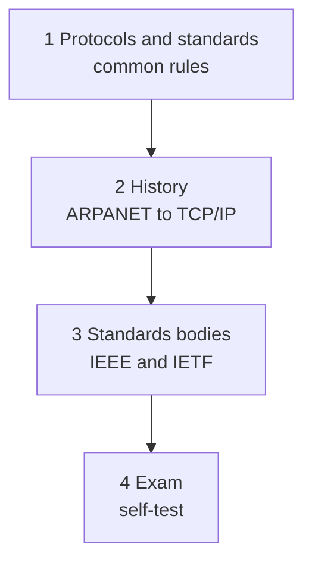
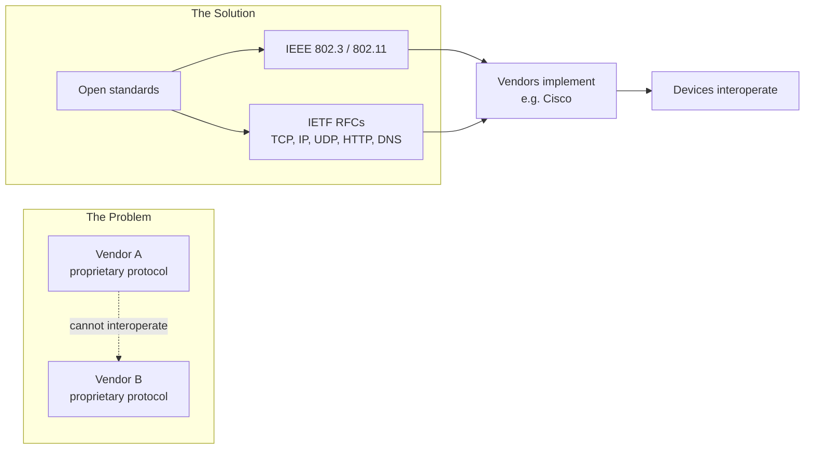

---
tags:
  - ccna
  - networking
  - tcpip
  - moc
aliases:
  - TCP/IP
  - TCP IP
  - 03 TCP IP
---

# 🌐 TCP/IP

> [!abstract] Folder Overview
> This folder covers the **rules and organizations behind internetworking** — why protocols and standards are needed, how TCP/IP grew out of ARPANET, and who defines the standards that vendors implement.

> [!tip] Start here — read top to bottom
> Finish [[Interfaces And Cables]] first. Work through the stages below in order — every note ends with a **🧭 Learning Path** link to the next one.

## 🧭 Learning Path

| # | Stage | Note | What you'll learn |
| --- | --- | --- | --- |
| 1 | 🌱 Basics | [[Standards And Protocols]] | Protocols, standards, and vendor neutrality |
| 2 | 📜 History | [[History]] | ARPANET → NCP → TCP/IP (1983) |
| 3 | 🏛️ Governance | [[Who Defines The Standards]] | IEEE, IETF, and RFCs |
| 4 | 📝 Check | [[TCP IP Exam]] | Test what you learned |

## 🏗️ Knowledge Hierarchy

## 🗺️ How the Pieces Fit Together

> [!example] Following the signal
> 1. Two devices need an **agreed-upon language** — a **protocol**.
> 2. **Vendor-proprietary** protocols made different vendors' devices unable to communicate.
> 3. **Vendor-neutral standards** solved that problem.
> 4. **IEEE** defines LAN standards (Ethernet 802.3, Wi-Fi 802.11); **IETF** publishes Internet protocols as **RFCs**.
> 5. Vendors such as Cisco implement the standards so devices work together — grouped into **layers** to make sense of them all.

## 🔑 Key Exam Points

> [!important] Must-know facts
> - A **protocol** is a set of rules defining how data is communicated between devices.
> - A **standard** is an agreed-upon specification describing how a protocol or technology works.
> - **Proprietary** (vendor-specific) protocols make interoperability between vendors difficult or impossible.
> - **Vendor-neutral** standards let devices from different companies communicate.
> - **IEEE** develops LAN standards: **802.3 = Ethernet**, **802.11 = Wi-Fi**. Its standards cover physical specs **and** message formatting.
> - **IETF** defines Internet protocols — **TCP, IP, UDP, HTTP, DNS** — and publishes them as **RFCs**.
> - **ARPANET** came online in **1969**, funded by the US DoD's **ARPA**, and originally used **NCP**.
> - **Vint Cerf and Bob Kahn** began developing **TCP in 1974**; it was later split into **TCP** and **IP**.
> - ARPANET fully switched to TCP/IP on **1 January 1983**.
> - TCP/IP became dominant because it was **open standards** any vendor could implement and could run over **many network types**.

## ⚖️ IEEE vs IETF

| Org | Full name | Focus | Examples | Publishes as |
| --- | --- | --- | --- | --- |
| **IEEE** | Institute of Electrical and Electronics Engineers | LAN physical & framing standards | 802.3 Ethernet, 802.11 Wi-Fi | 802.x standards |
| **IETF** | Internet Engineering Task Force | Internet protocols | TCP, IP, UDP, HTTP, DNS | RFCs (Requests for Comments) |

## 📜 TCP/IP Timeline

| Year | Event |
| --- | --- |
| **1960s** | Early network research begins in the US |
| **1969** | **ARPANET** comes online, funded by ARPA (US DoD) |
| Early days | ARPANET uses **NCP** (Network Control Program) |
| **1974** | **Vint Cerf and Bob Kahn** begin developing **TCP** (Transmission Control Program) |
| After revisions | TCP splits into **TCP** (Protocol) and **IP** (Internet Protocol) |
| **1 Jan 1983** | ARPANET fully switches to **TCP/IP** |
| Today | TCP/IP remains the foundation of the Internet |

## ✅ Exam Checklist

- [ ] I can define a **protocol** and explain the common-language analogy.
- [ ] I can define a **standard** and explain why vendor-neutral standards matter.
- [ ] I can explain why proprietary vendor protocols prevent interoperability.
- [ ] I can name the two key standards organizations — **IEEE** and **IETF**.
- [ ] I can state what **802.3** and **802.11** define.
- [ ] I can list examples of IETF protocols and explain what an **RFC** is.
- [ ] I can outline the history from **ARPANET/NCP** to **TCP/IP** and the **1983** cutover.
- [ ] I can explain why **open standards** made TCP/IP dominant.

## 📝 Practice Exam

- [[TCP IP Exam]] — 30-mark self-test with answers

---

### 🔗 Related Notes
[[Standards And Protocols]] · [[History]] · [[Who Defines The Standards]] · [[Network Protocols]] · [[Ethernet]] · [[Ethernet Standards (copper)]] · [[Interfaces And Cables]]
