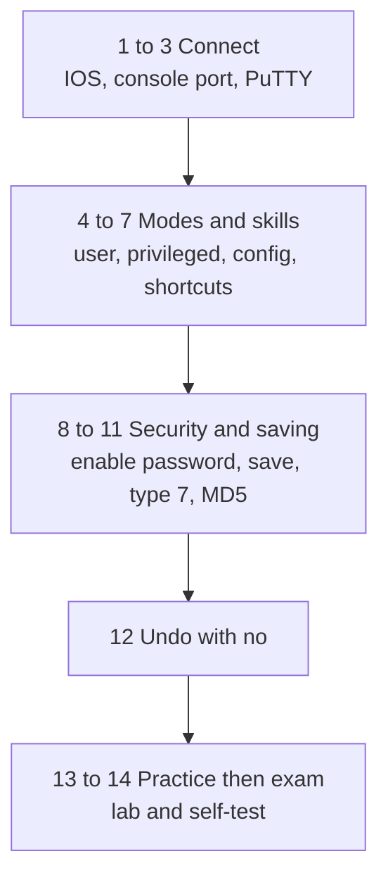

---
tags:
  - ccna
  - networking
  - cisco
  - cli
  - moc
aliases:
  - Intro To The CLI
  - IntroTOTheCLI
  - Introduction to the CLI
  - 04 IntroTOTheCLI
---

# 💻 Intro to the CLI

> [!abstract] Folder Overview
> This folder covers how to **connect to a Cisco device**, navigate the **IOS command-line interface**, move between its **modes**, and secure and save your configuration with passwords.

> [!tip] Start here — read top to bottom
> Finish [[TCP IP]] first. Work through the stages below in order — every note ends with a **🧭 Learning Path** link to the next one.

## 🧭 Learning Path

| # | Stage | Note | What you'll learn |
| --- | --- | --- | --- |
| 1 | 🌱 Basics | [[CLI]] | Cisco IOS, CLI vs GUI |
| 2 | 🔌 Connection | [[Console Port]] | Console ports and the **rollover cable** |
| 3 | 🔌 Connection | [[Terminal Emulator (PuTTY)]] | PuTTY and Cisco's **serial defaults** |
| 4 | 🚪 Modes | [[User EXEC Mode]] | `Router>` — read-only access |
| 5 | 🚪 Modes | [[Privileged EXEC Mode]] | `enable` → `Router#`, using `?` |
| 6 | ⌨️ Skills | [[Cisco IOS CLI Shortcuts]] | Tab, abbreviations, ambiguous commands |
| 7 | ⚙️ Modes | [[Global Configuration Mode]] | `configure terminal` → `Router(config)#` |
| 8 | 🔐 Security | [[Enable Password]] | Protect privileged EXEC mode |
| 9 | 💾 Saving | [[Saving Configuration]] | Three ways to save the config |
| 10 | 🔐 Security | [[Service Password Encryption]] | Type 7 encryption (weak) |
| 11 | 🔐 Security | [[Enable Secret Command]] | MD5 type 5 encryption (strong) |
| 12 | 🗑️ Skills | [[Canceling and Deleting a Command]] | Undo a command with `no` |
| 13 | 🧪 Practice | [[Day 04 Lab - Basic Device Security.pkt]] | Configure the device yourself |
| 14 | 📝 Check | [[Intro To The CLI Exam]] | Test what you learned |

## 🏗️ Knowledge Hierarchy



## 🗺️ How the Pieces Fit Together

```mermaid
flowchart LR
    subgraph CONNECT["Physical Connection"]
        L[Laptop] --> R[RJ-45 rollover cable]
        R --> CP[Console port on device]
    end

    subgraph ACCESS["Terminal Access"]
        CP --> PU[PuTTY terminal emulator<br/>9600 / 8 / 1 / none / none]
        PU --> CLI[Cisco IOS CLI]
    end

    subgraph MODES["CLI Modes"]
        U[User EXEC<br/>Router>] --> P[Privileged EXEC<br/>Router#]
        P --> G[Global Config<br/>Router(config)#]
    end

    CLI --> MODES
    G --> SEC[enable password / enable secret]
    G --> SAVE[write / copy running-config startup-config]
    G --> UNDO[no command to reverse]
    SEC --> LAB[Lab]
    SAVE --> LAB
    UNDO --> LAB
    LAB --> EXAM[Exam]
```

> [!example] Following a first-time setup
> 1. Connect your laptop to the device's **console port** using a **rollover cable** (and USB adapter if needed).
> 2. Open **PuTTY**, select **Serial**, and connect with Cisco's defaults (**9600, 8, 1, none, none**).
> 3. Decline the initial configuration dialog and press Enter — you land in **user EXEC mode** (`Router>`).
> 4. Type `enable` to reach **privileged EXEC mode** (`Router#`); `configure terminal` reaches **global configuration** (`Router(config)#`).
> 5. Set a password, **save** the configuration, then finish with the **lab** and **exam**.

## 🔑 Key Exam Points

> [!important] Must-know facts
> - **Cisco IOS** is the operating system of Cisco devices; it is **not** Apple's iOS. The **CLI** is the text interface used to configure them; most engineers prefer it over a **GUI**.
> - First-time configuration requires the **console port**. A Cisco Catalyst switch has **RJ-45** and **USB mini-B** console ports.
> - The console cable is a **rollover cable** (1→8, 2→7, …), not a crossover cable. A modern laptop usually needs a **USB-to-serial adapter**.
> - Use a **terminal emulator** such as **PuTTY**. Cisco serial defaults: **9600 bps, 8 data bits, 1 stop bit, no parity, no flow control**.
> - **User EXEC** (`Router>`) is limited/read-only. **Privileged EXEC** (`Router#`) gives full view and administrative access. **Global configuration** (`Router(config)#`) is where changes are made.
> - `enable` → privileged EXEC; `configure terminal` (short: `conf t`) → global configuration; `exit` moves back one level.
> - **`?`** lists commands: with **no space** it completes the current word; with a **space** it shows the next options. **`<cr>`** means press Enter.
> - **Tab** completes a command; short forms work only if **unambiguous**, otherwise IOS says **Ambiguous command**.
> - `enable password <password>` protects privileged EXEC mode. Passwords are **case-sensitive** and hidden when typed; **three** failures give **bad secrets**.
> - Save the config from privileged EXEC with **`write`**, **`write memory`**, or **`copy running-config startup-config`**.
> - `service password-encryption` produces weak **type 7** encryption; it can be reversed with `no service password-encryption`.
> - **`enable secret`** uses **MD5 type 5**, is **always encrypted**, and **overrides** `enable password` if both are set — always prefer it.
> - Prefix a command with **`no`** to undo it. Disabling password encryption does **not** decrypt existing passwords.

## 🚪 CLI Modes at a Glance

| Mode | Prompt | Enter with | Can do |
| --- | --- | --- | --- |
| **User EXEC** | `Router>` | Default on connect | Limited viewing only |
| **Privileged EXEC** | `Router#` | `enable` | View config, save, reload, set time |
| **Global configuration** | `Router(config)#` | `configure terminal` | Change the configuration |

## 🔐 Password Commands Compared

| Feature | `enable password` | `enable secret` | `service password-encryption` |
| --- | --- | --- | --- |
| **Where configured** | Global config | Global config | Global config |
| **Protects what** | Privileged EXEC | Privileged EXEC | Encrypts all clear-text passwords |
| **Encryption** | None, or **type 7** if SPE on | **MD5 type 5** | Cisco proprietary **type 7** |
| **Always encrypted?** | No | **Yes** | Only while enabled |
| **If both enable commands set** | Ignored | **Wins** | No effect on the secret |

## 💾 Save Commands

| Command | Mode | Result |
| --- | --- | --- |
| `write` | Privileged EXEC | Saves running-config → startup-config |
| `write memory` | Privileged EXEC | Same |
| `copy running-config startup-config` | Privileged EXEC | Same (most descriptive) |
| `show startup-config` | Privileged EXEC | Verifies the saved configuration |

## ⚙️ Cisco Serial Defaults

| Speed | Data bits | Stop bits | Parity | Flow control |
| --- | --- | --- | --- | --- |
| **9600 bps** | **8** | **1** | **None** | **None** |

## ✅ Exam Checklist

- [ ] I can explain what Cisco IOS and the CLI are, and why engineers prefer the CLI.
- [ ] I can describe the console port, the rollover cable pinout, and the need for a USB adapter.
- [ ] I can list Cisco's serial defaults for a terminal emulator.
- [ ] I can identify the three CLI modes by prompt and state what each allows.
- [ ] I can use `enable`, `configure terminal`, and `exit` to move between modes.
- [ ] I can use `?` and Tab, and explain ambiguous commands.
- [ ] I can configure `enable password` and explain case sensitivity and bad secrets.
- [ ] I can name the three commands that save the running configuration.
- [ ] I can compare type 7 encryption with MD5 type 5 and explain why `enable secret` wins.
- [ ] I can use `no` to undo a command and explain its effect on password encryption.

## 🧪 Lab

- [[Day 04 Lab - Basic Device Security.pkt]]

## 📝 Practice Exam

- [[Intro To The CLI Exam]] — 30-mark self-test with answers

---

### 🔗 Related Notes
[[CLI]] · [[Console Port]] · [[Terminal Emulator (PuTTY)]] · [[User EXEC Mode]] · [[Privileged EXEC Mode]] · [[Cisco IOS CLI Shortcuts]] · [[Global Configuration Mode]] · [[Enable Password]] · [[Saving Configuration]] · [[Service Password Encryption]] · [[Enable Secret Command]] · [[Canceling and Deleting a Command]] · [[TCP IP]]
