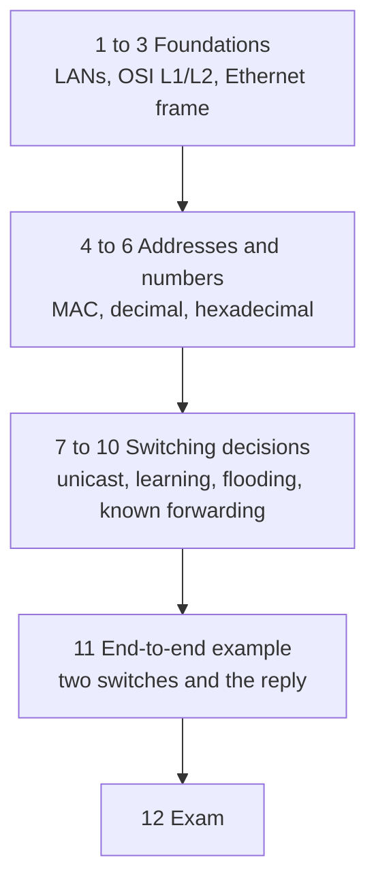
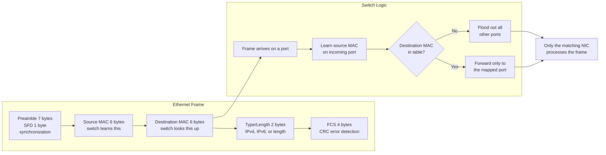

---
tags:
  - ccna
  - networking
  - ethernet
  - switching
  - lan
  - moc
aliases:
  - Ethernet LAN Switching
  - Ethernet LAN Switching 1
  - 05 Ethernet LAN Switching
  - 05 Ethernet LAN Switching 1
---

# 🔀 Ethernet LAN Switching

> [!abstract] Folder Overview
> This folder explains how devices deliver **Ethernet frames inside a LAN**: Layer 1/2 review, frame fields, MAC addresses, decimal and hexadecimal numbers, and the switch rules for **learning, flooding, and forwarding**.

> [!tip] Start here — read top to bottom
> Finish [[Intro To The CLI]] first. Work through the stages below in order — every note ends with a **🧭 Learning Path** link to the next one. Then test yourself with [[Ethernet LAN Switching Exam]].

## 🧭 Learning Path

| # | Stage | Note | What you'll learn |
| --- | --- | --- | --- |
| 1 | 🌍 LANs | [[Local Area Networks]] | What a LAN is; routers separate LANs, switches expand them |
| 2 | 🧭 Review | [[OSI Model Review]] | Layers 1 and 2, PDUs, encapsulation |
| 3 | 🧱 Frames | [[Ethernet Frame]] | Preamble, SFD, MAC fields, Type/Length, FCS |
| 4 | 🆔 Addresses | [[MAC Address]] | 48-bit physical addresses, OUI, burned-in address |
| 5 | 🔢 Numbers | [[Decimal Number System]] | Base 10 and place values |
| 6 | 🧮 Numbers | [[Hexadecimal Number System]] | Base 16, A–F, hex counting |
| 7 | 📨 Frames | [[Unicast Frames]] | A frame for one target |
| 8 | 🗂️ Tables | [[CCNA/05 Ethernet LAN Switching  1/MAC Address Table]] | Learning from the **source** MAC |
| 9 | 🌊 Flooding | [[Unknown Unicast Flooding]] | No table entry → flood all other ports |
| 10 | 🎯 Forwarding | [[Known Unicast Forwarding]] | Known destination → forward only to its port |
| 11 | 🔁 Example | [[MAC Learning Frame Flooding and Forwarding Process]] | Full two-switch walkthrough and reply |
| 12 | 📝 Check | [[Ethernet LAN Switching Exam]] | 30-mark self-test with answers |

## 🏗️ Knowledge Hierarchy

## 🗺️ How the Pieces Fit Together

> [!example] Following PC1 → PC2, then the reply
> 1. **PC1** sends a frame: source = PC1's MAC, destination = PC2's MAC.
> 2. **SW1** learns PC1's **source MAC** on the port where the frame arrived.
> 3. SW1 has no entry for PC2, so the frame is an **unknown unicast** and is **flooded** out every other port.
> 4. **PC3** drops it; **PC2** accepts it and processes it up the OSI stack.
> 5. If PC2 replies, SW1 learns PC2's source MAC. The destination (PC1) is now **known**, so the reply is **forwarded only** to PC1 — no flood.
> 6. If PC2 never replies, SW1 never learns PC2, so the next PC1 frame is flooded again.

## 🔑 Key Exam Points

> [!important] Must-know facts
> - A **LAN** is a network in a relatively small area, such as a home or one office floor. **Routers connect separate LANs**; switches **expand** a LAN but do **not** separate LANs.
> - Ethernet uses **Layer 1 and Layer 2**. Switches operate at **Layer 2**. **IP addresses are Layer 3**, not Layer 2.
> - The PDU sequence is **data → segment (L4 header) → packet (L3 header) → frame (L2 header + trailer)**.
> - The Ethernet frame fields are **Preamble 7 B**, **SFD 1 B**, **Destination 6 B**, **Source 6 B**, **Type/Length 2 B**, and **FCS 4 B** — **26 bytes** of header and trailer.
> - The preamble is `10101010` repeated **7 times** and synchronizes receiver clocks. The SFD is `10101011` and marks the start of the rest of the frame.
> - **Type/Length ≤ 1500** means length in bytes; **≥ 1536** means type. `0x0800` = **2048** = IPv4; `0x86DD` = **34525** = IPv6. `0x` means hexadecimal.
> - The **FCS** is **4 bytes / 32 bits** and uses a **CRC** (Cyclic Redundancy Check) to **detect** corruption. For CCNA, know that the FCS is a CRC; detailed CRC math is not required.
> - A **MAC address** is a **6-byte / 48-bit physical address** assigned when the device is made. It is also called a **burned-in address (BIA)** and is different from an IP address configured in the CLI.
> - MAC addresses are **globally unique** in almost all cases; **locally unique** MAC addresses exist but do not have to be globally unique.
> - The first **3 bytes** are the **OUI** (Organizationally Unique Identifier), assigned to the manufacturer. The last **3 bytes** identify the device itself.
> - A MAC address is **12 hexadecimal characters**, often written as `AAAA.AA00.0001` or `AA.AA.AA.00.00.01`.
> - A switch fills its MAC address table by looking at the **SOURCE MAC** of an arriving frame and mapping it to the **incoming interface**. That entry means *reachable via* that interface — not necessarily directly connected.
> - **Unknown unicast** = destination not in the table → **flood** out all ports except the incoming port. **Known unicast** = destination in the table → **forward** only to that port.
> - On Cisco switches, **dynamic MAC entries are removed after 5 minutes of inactivity** and are learned again when the host sends traffic.

## 🧱 Ethernet Frame at a Glance

| Field | Size | Purpose |
| --- | --- | --- |
| **Preamble** | 7 bytes | Alternating `10101010` pattern; receiver clock synchronization |
| **SFD** | 1 byte | `10101011`; ends the preamble and marks the frame start |
| **Destination MAC** | 6 bytes | Layer 2 address of the intended recipient |
| **Source MAC** | 6 bytes | Layer 2 address of the sender; used by switches to learn |
| **Type/Length** | 2 bytes | Packet type (IPv4/IPv6) or encapsulated length |
| **FCS** | 4 bytes | CRC used to detect transmission errors |
| **Total header + trailer** | **26 bytes** | 7 + 1 + 6 + 6 + 2 + 4 |

## 🚦 Switch Decision Table

| Situation | What the switch does | Ports used |
| --- | --- | --- |
| **Source MAC** seen on a frame | Learns/updates MAC → incoming port | Incoming port only |
| **Unknown unicast** destination | Floods the frame | All ports **except** incoming |
| **Known unicast** destination | Forwards the frame | Only the port mapped to that MAC |
| **Wrong destination MAC** received by a host | Host drops the frame | None — the NIC ignores it |

## 🔢 Number Systems at a Glance

| System | Digits | Column values | Example |
| --- | --- | --- | --- |
| **Decimal** | `0–9` | 1, 10, 100, 1000 | `25` = 2 tens + 5 ones |
| **Hexadecimal** | `0–9`, `A–F` | 1, 16, 256, 4096 | `0x10` = 1 sixteen + 0 ones = decimal **16** |

## ✅ Exam Checklist

- [ ] I can define a LAN and explain why routers separate LANs but switches do not.
- [ ] I can state what Layer 1 and Layer 2 do and why this folder focuses on Layer 2.
- [ ] I can list the PDU names for L4, L3, and L2 and say what is added at each step.
- [ ] I can name all Ethernet frame fields and their byte lengths.
- [ ] I can explain the preamble, SFD, Type/Length rule, `0x0800`, `0x86DD`, and FCS/CRC.
- [ ] I can describe a MAC address as 48 bits, explain OUI vs device portion, and recognize BIA.
- [ ] I can convert simple hex digits such as `A–F` and hex values such as `0x10`.
- [ ] I can explain why a switch learns from the **source** MAC only.
- [ ] I can contrast unknown unicast flooding with known unicast forwarding.
- [ ] I can state the 5-minute Cisco dynamic MAC aging rule.
- [ ] I can trace PC1 → PC3 and PC3's reply through two switches.

## 📝 Practice Exam

- [[Ethernet LAN Switching Exam]] — 30-mark self-test with answers

---

### 🔗 Related Notes
[[Local Area Networks]] · [[OSI Model Review]] · [[Ethernet Frame]] · [[MAC Address]] · [[Decimal Number System]] · [[Hexadecimal Number System]] · [[Unicast Frames]] · [[CCNA/05 Ethernet LAN Switching  1/MAC Address Table]] · [[Unknown Unicast Flooding]] · [[Known Unicast Forwarding]] · [[MAC Learning Frame Flooding and Forwarding Process]] · [[Local 2 Network Layer]] · [[Encapsulation & decapsulation]] · [[Intro To The CLI]]
