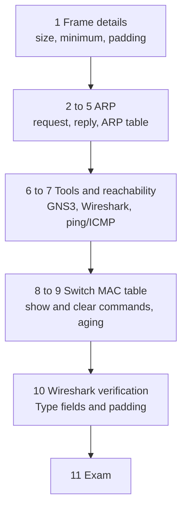
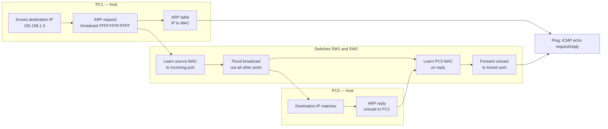

---
tags:
  - ccna
  - networking
  - ethernet
  - switching
  - arp
  - moc
aliases:
  - Ethernet LAN Switching 2
  - Ethernet LAN Switching Part 2
  - 06 Ethernet LAN Switching 2
---

# 🔀 Ethernet LAN Switching 2 — ARP, Ping & Frame Details

> [!abstract] Folder Overview
> This folder completes **Ethernet LAN Switching**: frame size and padding, **ARP** (request/reply and ARP tables), **ping/ICMP**, the Cisco switch **MAC address table** and its commands, and **Wireshark** verification of the whole process.

> [!tip] Start here — read top to bottom
> Finish [[Ethernet LAN Switching]] first. Work through the stages below in order — every note ends with a **🧭 Learning Path** link to the next one. Then test yourself with [[Ethernet LAN Switching 2 Exam]].

## 🧭 Learning Path

| # | Stage | Note | What you'll learn |
| --- | --- | --- | --- |
| 1 | 🧱 Frames | [[Ethernet Frame 2]] | 18-byte header + trailer, 64-byte minimum frame, 46-byte payload, padding |
| 2 | 🔍 Resolution | [[ARP]] | MAC from IP, two messages, broadcast request vs unicast reply |
| 3 | 📢 Request | [[ARP Request]] | `FFFF.FFFF.FFFF`, switch learning/flooding, host filtering by IP |
| 4 | 📨 Reply | [[ARP Reply]] | Unicast reply, switch learning, ARP table update |
| 5 | 🗃️ Host table | [[ARP Table]] | `arp -a`, static vs dynamic entries |
| 6 | 🧪 Tools | [[GNS3 Sim]] | GNS3 (real IOS) vs Packet Tracer (simulator), Wireshark integration |
| 7 | 📡 Reachability | [[Ping]] | ICMP echo request/reply, first ping failure, IOS output, `show arp` |
| 8 | 🗂️ Switch table | [[CCNA/06 Ethernet LAN Switching 2/MAC Address Table]] | `show mac address-table`, VLAN/type/ports, 5-minute aging |
| 9 | 🧹 Clearing | [[Clearing The MAC address Table]] | `clear mac address-table dynamic` and its options |
| 10 | 🔬 Capture | [[Wireshark packet capture]] | ARP → ICMP capture, Ethernet Type values, padding proof |
| 11 | 📝 Check | [[Ethernet LAN Switching 2 Exam]] | 30-mark self-test with answers |

## 🏗️ Knowledge Hierarchy

## 🗺️ How the Pieces Fit Together

> [!example] PC1 → PC3, end to end
> 1. PC1 knows PC3's **IP** (`192.168.1.3`) but not its **MAC**, so it sends an **ARP request** with destination MAC `FFFF.FFFF.FFFF`.
> 2. SW1 learns PC1's **source MAC** on G0/0 and **floods** the broadcast out G0/1 and G0/2. SW2 learns PC1 on G0/2 and floods out G0/0 and G0/1.
> 3. PC2 and PC4 ignore it (IP mismatch). **PC3** matches the IP and sends a **unicast ARP reply** (source MAC `0c2f.b06a.3900`) — it learned PC1's MAC from the request's source MAC.
> 4. SW2 learns PC3 on G0/0 and **forwards** (no flood) to PC1; SW1 learns PC3 and forwards to PC1. PC1 adds PC3 to its **ARP table**.
> 5. PC1 now sends the **ping**: ICMP Echo Request to PC3, Echo Reply back. The first ping fails while ARP runs; the remaining 4 succeed.
> 6. Wireshark confirms: ARP request → ARP reply → 4 ICMP requests → 4 ICMP replies.

## 🔑 Key Exam Points

> [!important] Must-know facts
> - The **preamble + SFD** are sent with every frame but usually **excluded** from the Ethernet header. Header + trailer = **18 bytes** without them, **26 bytes** with them.
> - **Minimum Ethernet frame = 64 bytes** (excluding preamble/SFD) → **minimum payload = 46 bytes** (64 − 18). Shorter payloads get **all-zero padding** (34-byte packet → 12 bytes).
> - **ARP = Address Resolution Protocol**: discovers the **Layer 2 MAC** of a known **Layer 3 IP**. Switches use MACs, not IPs — they are Layer 2 devices.
> - ARP has exactly **two messages**: **request** = **broadcast** to all hosts (`FFFF.FFFF.FFFF`); **reply** = **unicast** to the requester.
> - ARP request keeps the same source IP, destination IP and source MAC as the intended frame; only the destination MAC becomes **all Fs**.
> - Switches **learn the source MAC → incoming port** (dynamic) and **flood the broadcast** out every port except the incoming one; hosts filter by the **destination IP**.
> - The ARP reply is unicast because the requester's MAC was the **source MAC** of the broadcast request.
> - `arp -a` (Windows/macOS/Linux) shows **Internet address (IP)**, **Physical address (MAC)**, and **Type**: **static** = default/not learned; **dynamic** = learned via request/reply.
> - **Ping** tests reachability and round-trip time with **ICMP Echo Request / Echo Reply**; it is **unicast**, so **ARP must resolve the MAC first**.
> - Cisco IOS ping defaults: **5 × 100-byte** echos; `!` = success, `.` = failure; a failed first ping is typically the **ARP delay**. `show arp` views the IOS ARP table.
> - `show mac address-table` columns: **VLAN** (default **1**), **MAC Address**, **Type** (**dynamic** = learned, not configured), **Ports** (interfaces). Older IOS used `show mac-address-table`.
> - **Dynamic MAC entries age out after 5 minutes** of inactivity and are relearned when the host sends traffic again.
> - `clear mac address-table dynamic` clears all dynamic entries; add **`address <mac>`** for one MAC or **`interface <port>`** for one port.
> - **GNS3 runs real Cisco IOS** (IOS licence required) while **Packet Tracer simulates** a network (free). GNS3 integrates with **Wireshark** for packet captures.
> - Ethernet **Type** values: **IPv4 `0x0800`**, **IPv6 `0x86DD`**, **ARP `0x0806`**. `0x` = hexadecimal. Wireshark showed **20 hex zeros = 10 bytes** of padding for a 36-byte ping.

## 📊 Quick Reference Tables

### ARP Request vs ARP Reply

| | **ARP Request** | **ARP Reply** |
| --- | --- | --- |
| Sender | Device that needs the MAC (PC1) | Device with the matching IP (PC3) |
| Destination | All hosts on the LAN | Only the requester |
| Frame type | **Broadcast** — `FFFF.FFFF.FFFF` | **Unicast** — requester's MAC |
| Source MAC | Requester's MAC | Responder's MAC |
| Switch behaviour | Learn source MAC, **flood** | Learn source MAC, **forward** |

### Two Different Tables

| Table | Kept by | Maps | View with |
| --- | --- | --- | --- |
| **MAC address table** | Switches | MAC → interface (VLAN, type, port) | `show mac address-table` |
| **ARP table** | Hosts / routers | IP → MAC | `arp -a` / `show arp` |

### Commands in This Folder

| Command | Where | Purpose |
| --- | --- | --- |
| `arp -a` | Windows / macOS / Linux | View the ARP table |
| `ping 192.168.1.3` | Host / IOS CLI | Test reachability with ICMP |
| `show arp` | Cisco IOS privileged EXEC | View the ARP table |
| `show mac address-table` | Cisco switch IOS | View learned MAC → port entries |
| `clear mac address-table dynamic` | Cisco switch IOS | Clear all dynamic MAC entries |
| `clear mac address-table dynamic address <mac>` | Cisco switch IOS | Clear one MAC entry |
| `clear mac address-table dynamic interface <port>` | Cisco switch IOS | Clear entries for one interface |
| `ping 192.168.1.3 SIZE 36` | Cisco IOS CLI | Send a 36-byte ping (padding demo) |

### Ethernet Frame Numbers

| Item | Value |
| --- | --- |
| Header + trailer (without preamble/SFD) | **18 bytes** |
| Header + trailer (with preamble/SFD) | **26 bytes** |
| Minimum frame (without preamble/SFD) | **64 bytes** |
| Minimum payload | **46 bytes** |
| Padding for a 34-byte payload | **12 bytes** |
| Padding for a 36-byte payload | **10 bytes** |

## ✅ Exam Checklist

- [ ] I can calculate the minimum payload (46 bytes) from the minimum frame (64) and header/trailer (18).
- [ ] I can explain why padding is added and that it consists of zeros.
- [ ] I can define ARP and state that it resolves an IP to a MAC.
- [ ] I can contrast the broadcast ARP request with the unicast ARP reply.
- [ ] I can trace ARP through two switches, including what each switch learns and which ports it uses.
- [ ] I can read an ARP table and distinguish static from dynamic entries.
- [ ] I can explain ping/ICMP and why the first ping commonly fails (ARP first).
- [ ] I can read Cisco IOS ping output (`5`, `100-byte`, `!`, `.`, success rate, RTT).
- [ ] I can list the `show mac address-table` columns and the 5-minute aging rule.
- [ ] I can write the three `clear mac address-table dynamic` variants.
- [ ] I can identify Ethernet Type `0800`, `86DD`, and `0806` and explain Wireshark padding.
- [ ] I can state how GNS3 differs from Packet Tracer and why Wireshark is useful.

## 📝 Practice Exam

- [[Ethernet LAN Switching 2 Exam]] — 30-mark self-test with answers

---

### 🔗 Related Notes
[[ARP]] · [[ARP Request]] · [[ARP Reply]] · [[ARP Table]] · [[Ethernet Frame 2]] · [[GNS3 Sim]] · [[Ping]] · [[CCNA/06 Ethernet LAN Switching 2/MAC Address Table]] · [[Clearing The MAC address Table]] · [[Wireshark packet capture]] · [[Ethernet LAN Switching]] · [[Ethernet LAN Switching Exam]]
